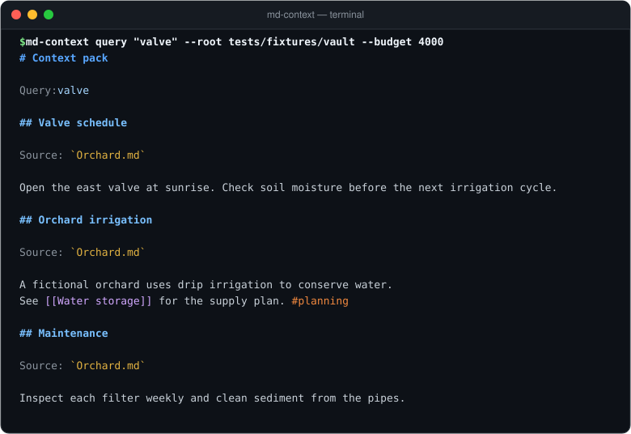

# md-context
[](https://github.com/YusufBeratZengin/md-context/actions/workflows/ci.yml) [](https://pypi.org/project/md-context/) [](https://www.python.org/) [](LICENSE)<br>
[English](README.md) | [Türkçe](README.tr.md)

## Demo
<br>
Build token-budgeted context packs for LLMs from local Markdown notes and Obsidian vaults.<br>
Runs entirely locally with zero runtime dependencies, combining BM25 ranking with links between notes.<br>
Install from a checkout: `python -m pip install .`<br>
`md-context query "valve" --root tests/fixtures/vault --cache-dir .cache --budget 4000`

## Why md-context?

- **Strict token budgets without overrun**: Guarantees the complete rendered output (including file paths, headings, and JSON framing) strictly obeys your token budget—preventing unexpected LLM context window overflow and API errors.
- **Graph-aware BM25 ranking**: Combines BM25 keyword relevance with title/tag boosts, recency decay, and bidirectional 1-hop link/tag graph spreading—delivering high-precision context from linked personal notes without needing embeddings or a vector database.
- **Local, fast, and privacy-first**: Zero runtime dependencies, zero external network calls, and instant startup. Strict privacy boundaries exclude `visibility: private` notes and `.mdcontextignore` patterns before text ever reaches memory or the cache snapshot.

## Install

Install from PyPI (available once published; until then `python -m pip install .` from a checkout):

```sh
python -m pip install md-context
```

## Quick start

### 1. Try with sample vault

Run the quickstart commands using a custom cache directory:

```sh
md-context index tests/fixtures/vault --cache-dir .cache
md-context query "valve" --root tests/fixtures/vault --cache-dir .cache --budget 4000
md-context stats --root tests/fixtures/vault --cache-dir .cache
```

Captured terminal output:

```text
$ md-context index tests/fixtures/vault --cache-dir .cache
{"notes": 4, "chunks": 8, "links": 2, "tags": 8, "tag_edges": 9, "excluded": 3, "strip_diacritics": false}

$ md-context query "valve" --root tests/fixtures/vault --cache-dir .cache --budget 4000
# Context pack

Query: valve

## Valve schedule

Source: `Orchard.md`

Open the east valve at sunrise. Check soil moisture before the next irrigation cycle.

## Orchard irrigation

Source: `Orchard.md`

A fictional orchard uses drip irrigation to conserve water.
See [[Water storage]] for the supply plan. #planning

## Maintenance

Source: `Orchard.md`

Inspect each filter weekly and clean sediment from the pipes.

## Water storage

Source: `Water storage.md`

A demonstration tank holds rainwater for the orchard.

## Capacity

Source: `Water storage.md`

Reserve one quarter of the tank for dry weather. [[Orchard]]

$ md-context stats --root tests/fixtures/vault --cache-dir .cache
{"notes": 4, "chunks": 8, "links": 2, "tags": 8, "tag_edges": 9, "excluded": 3, "strip_diacritics": false}
```

### 2. Run without installation

POSIX shell:

```sh
PYTHONPATH=src python -m md_context query "water storage" --root tests/fixtures/vault --cache-dir .cache
```

PowerShell equivalent:

```powershell
$env:PYTHONPATH = 'src'
$env:PYTHONUTF8 = '1'
py -m md_context query 'water storage' --root tests/fixtures/vault --cache-dir .cache
```

### 3. Working from inside your vault

```sh
cd /path/to/notes
md-context index . --strip-diacritics
md-context query "irrigation" --budget 4000
md-context query "irrigation" --budget 4000 --format json
md-context query "irrigation" --top 2 --include-tag gardening
md-context stats
```

## Usage examples

### Piping into an LLM or agent CLI

With a local agent command that accepts context on standard input:

```sh
md-context query "irrigation valve schedule" --root ./notes --budget 4000 | local-agent
```

`local-agent` is a placeholder for your own agent CLI. md-context makes no network requests. The receiving command determines where the selected text goes; review the pack before sending it to any external service.

Example Markdown output (excerpt):

```markdown
# Context pack

Query: valve

## Valve schedule

Source: `Orchard.md`

Open the east valve at sunrise. Check soil moisture before the next irrigation cycle.
```

JSON output (`--format json`) contains `query`, `budget`, `estimated_tokens`, and a `sources` array. Each source has `path` (relative to the vault), `title`, `heading`, `content`, `score`, and `truncated`. Scores describe note relevance; selection also favors matching sections. No matches produce an empty pack. A tiny budget that cannot hold the output envelope produces an error.

### CLI options for `query`

- `--budget N`: Maximum token budget for the complete output (default: `4000`).
- `--format md|json`: Output format; defaults to `md`. Invalid choices exit with status 2.
- `--top N`: Maximum number of sections to include in the context pack. Must be positive.
- `--include-tag TAG`: Only include notes with this tag (repeatable for multiple tags).
- `--exclude-tag TAG`: Exclude notes with this tag (repeatable for multiple tags).
- `--cache-dir PATH`: Custom directory to read and write the index cache snapshot.
- `--root PATH`: Vault root folder.

### Python API

```python
from md_context import build_index, build_pack, load_index, save_index, search

# 1. Build an index in memory
index = build_index("./notes", strip_diacritics=True)
save_index(index)  # Optional: persists to .md-context/index.json

# 2. Search notes
matches = search(index, "water", title_boost=2.0, neighbor_boost=0.2)

# 3. Build a token-budgeted context pack
pack = build_pack(
    index,
    "water",
    budget=4000,
    top=5,
    include_tags=["gardening"],
    output_format="json",
)
print(pack.to_json(), end="")

# 4. Plug in a custom tokenizer
# pack = build_pack(index, "water", estimator=lambda text: len(encoder.encode(text)))
```

Custom estimators must be deterministic and return a non-negative integer. Prefix search fills the budget best with monotone counters. The final rendered output is re-measured to guarantee budget compliance.

### How retrieval works

- Unicode word tokens use case folding. `I`, `İ`, `ı`, and `i` match each other; optional diacritic folding also makes `café` match `cafe`.
- BM25 uses `k1=1.2`, `b=0.75`. Title and tag matches add boosts of 2.0 and 1.5 times the term's inverse document frequency.
- Recency multiplies lexical scores by up to 1.15, decaying with a 90-day time scale. It uses a valid `updated`, otherwise `date`, otherwise filesystem mtime. An invalid chosen date falls back to mtime; naive dates use UTC. Future dates receive the maximum recency boost.
- `[[wikilinks]]`, `[[note#section|label]]`, and shared `#tags` connect notes. A 1-hop neighbor gets 0.2 times its strongest lexical neighbor's score. Links work in both directions; tag groups also connect members without self-boost. There is no recursive propagation.
- Link targets resolve by vault path, then source-relative path, then unique filename stem or title. Ambiguous and missing targets are ignored. Frontmatter aliases are parsed but are not used for link resolution. Tags and links inside fenced or inline code are ignored.
- ATX headings (`#` through `######`) split sections; fenced code is preserved. Setext headings are kept as body text. Sections are sorted by note score and query overlap, with stable path and section-order tie breaking. Oversized sections may be prefix-trimmed and marked as truncated.

The default token estimate is `ceil(character_count / 4)`, **not a model tokenizer**. The budget covers the complete serialized output, including query, paths, headings, JSON metadata, and truncation markers. Character truncation can cut a sentence or code block. No room is reserved for your agent's system prompt, tools, or answer.

### Performance and benchmark

md-context caches the pre-tokenized corpus and inverted index in memory on the loaded `Index` object without altering the persisted cache schema version.

On a synthetic benchmark of 2,000 notes (`scripts/benchmark.py`):
- `build_index`: ~6.6 s
- `save_index`: ~0.10 s
- `load_index`: ~0.03 s
- 20 queries: ~1.5 s total (~76 ms/query; first query warmup ~130 ms)

*(Approximate, machine dependent numbers measured on Python 3.11).*

## Examples

Ready-to-use pipe scripts are provided in [`examples/agent-pipe.sh`](examples/agent-pipe.sh) and [`examples/agent-pipe.ps1`](examples/agent-pipe.ps1).

## Configuration

### Frontmatter metadata

Notes with YAML frontmatter at the start of the file are parsed for titles, tags, dates, and privacy:

```yaml
---
title: "Orchard irrigation"
tags: [gardening, water]
date: 2026-01-15
updated: "2026-02-01T09:00:00Z"
visibility: public
---
```

- Flat `key: value` pairs, inline lists, block lists, quoted strings, and comments are supported.
- Double quotes use JSON string escapes; single quotes escape an apostrophe by doubling it.
- Dates and scalars are preserved as strings.
- Nested mappings, YAML anchors, and multiline scalars are unsupported and cause an error. Duplicate keys and unclosed frontmatter also fail. Frontmatter must start at the beginning of the file; a UTF-8 BOM is allowed.
- Set `visibility: private` to completely exclude a note before its text enters the cache or retrieval results.

### Ignored files (`.mdcontextignore`)

Place a `.mdcontextignore` file in the root of your vault to exclude files using glob syntax:

```gitignore
# Basename patterns match at any depth
scratch-*.md
archive/

# Paths containing / are relative to the vault root
drafts/**/*.md
!drafts/ready.md
```

- Patterns are case-sensitive on all platforms.
- `*`, `?`, and character classes match within a path segment; `**` matches zero or more segments.
- A leading `/` anchors to the vault root; a trailing `/` matches directories.
- Later `!` rules re-include matches, even inside an ignored directory.
- Built-in exclusions: `.git/`, `.obsidian/`, `.md-context/`, and symlinks are always ignored and cannot be overridden.

### Cache storage and discovery

- By default, index snapshots are stored in `.md-context/index.json` under your vault root.
- Override cache path using `--cache-dir PATH` or the `MD_CONTEXT_CACHE` environment variable.
- In CLI mode, `query` and `stats` automatically discover the nearest `.md-context/index.json` in parent folders. Use `--root <dir>` from anywhere; an existing index is optional for this form.
- Every CLI query and stats call rescans the source folder and replaces that snapshot, preserving the normalization option. Deleted, newly private, and newly ignored notes therefore leave the next successful snapshot and query.
- The cache contains full text of included notes. Keep `.md-context/` out of version control and backups that should not contain note content. See [SECURITY.md](SECURITY.md).

### Normalization options

- Pass `--strip-diacritics` during `index` to fold accents (e.g., `café` matches `cafe`).
- Turkish dotted and dotless `i` / `I` / `İ` / `ı` are handled natively without flags.
- Re-index without `--strip-diacritics` to turn accent folding off.

## FAQ and limitations

### Is md-context a vector database or embedding search?
No. `md-context` uses BM25 lexical ranking combined with link-graph propagation and recency weighting. It requires zero GPU compute, no model weights, and no remote embedding API calls.

### How is token estimation calculated?
By default, token count is estimated with `ceil(character_count / 4)`. You can pass a custom exact tokenizer (e.g. `tiktoken` or Hugging Face tokenizers) via the Python API `estimator` argument. The budget covers the complete serialized Markdown or JSON output envelope.

### What frontmatter syntax is supported?
The built-in parser supports flat key-value pairs, inline lists, block lists, quoted strings, and comments. Complex YAML features like nested mappings and anchors are intentionally rejected to maintain security and avoid heavyweight YAML dependencies.

### Are symlinks followed?
No. Symlink files and directories are ignored to prevent accidental directory traversal outside your vault. The cache and ignore file themselves cannot be symlinks.

### What happens if a folder has no Markdown files?
`index` produces an index with 0 notes, `query` returns an empty context pack with exit status 0, and `stats` reports `{"notes": 0, ...}`. Invalid frontmatter, corrupt cache files, or unreadable non-UTF-8 files fail the operation with exit status 2 and a diagnostic naming the offending file on stderr, never an unhandled traceback.

## Development

1. Fork the repository and clone it locally.
2. Install development dependencies:
   ```sh
   python -m pip install -e ".[dev]"
   ```
3. Run tests with coverage:
   ```sh
   python -m pytest
   ```
4. Verify code formatting, linting, and types:
   ```sh
   python -m ruff check .
   python -m ruff format --check .
   python -m mypy src
   ```

## Contributing

Contributions, bug reports, and suggestions are welcome!

Please see [CONTRIBUTING.md](CONTRIBUTING.md) and [CODE_OF_CONDUCT.md](CODE_OF_CONDUCT.md) for detailed guidelines. Releases and changes are tracked in [CHANGELOG.md](CHANGELOG.md).

## License

This project is licensed under the [MIT License](LICENSE).
